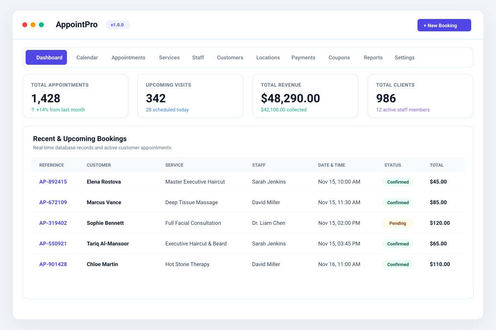
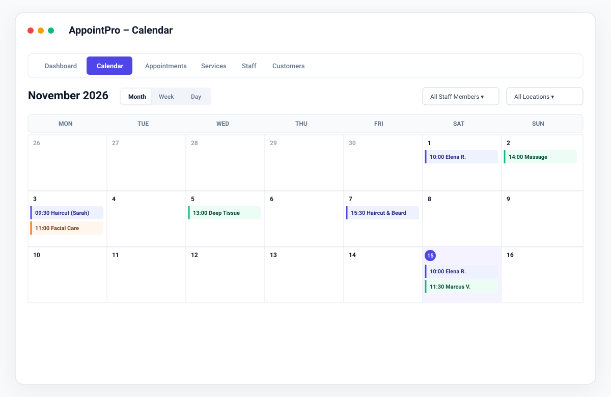
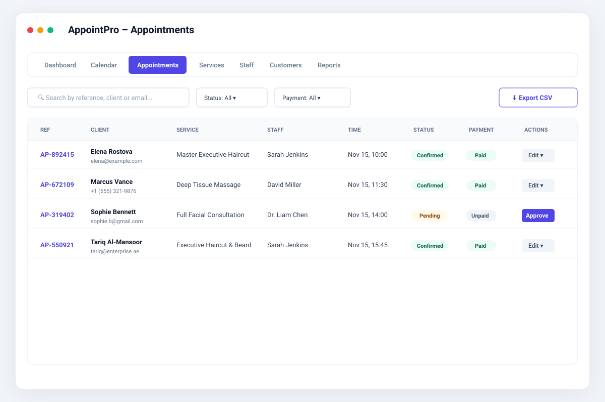
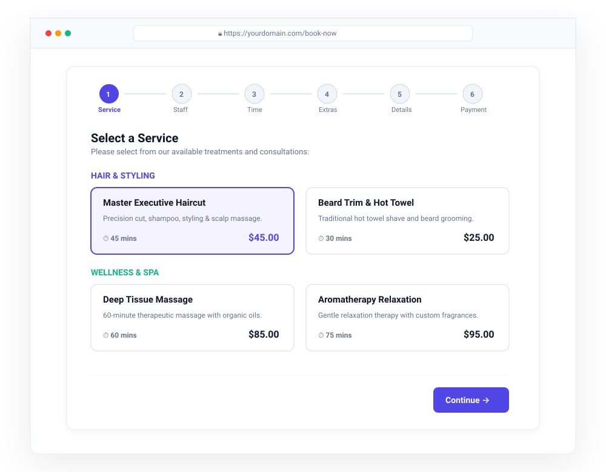
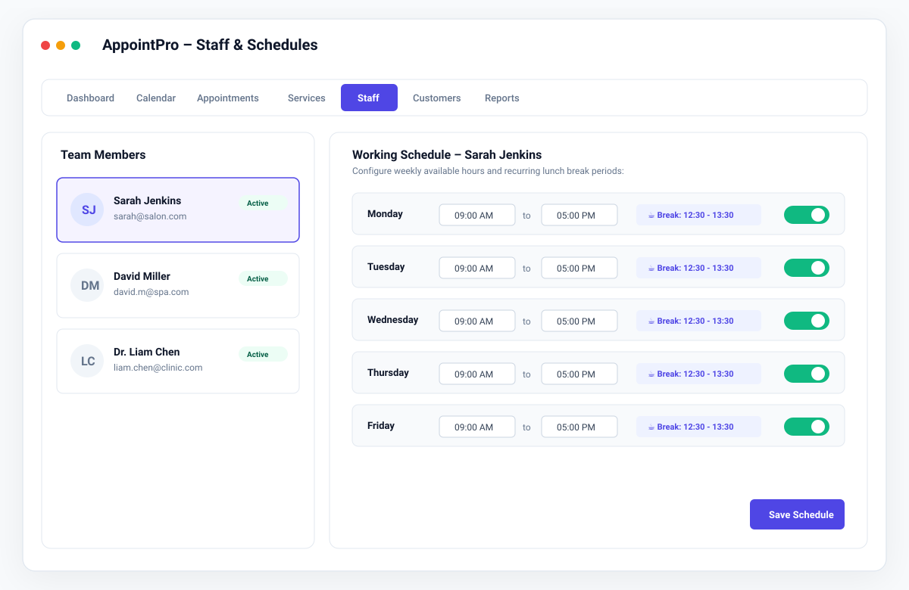
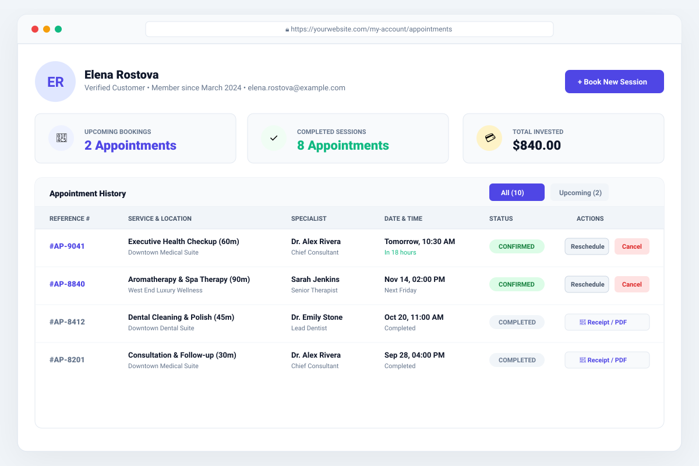

# AppointPro – Ultimate WordPress Appointment Booking & Scheduling System

[](https://wordpress.org)
[](https://php.net)
[-success.svg?style=flat-square)](TEST_REPORT.md)
[](LICENSE)
[](https://codecanyon.net)

> **AppointPro** is a high-performance, enterprise-grade WordPress appointment booking and scheduling system built from the ground up for medical clinics, spas, salons, fitness studios, legal consultancies, and all appointment-based businesses worldwide.

---

## 🌟 Live Interactive Demo Link

Experience AppointPro live in your browser (both Customer Booking Wizard & Admin SaaS Dashboard) without needing a local WordPress install:

👉 **[Launch AppointPro Live Interactive Demo](demo/index.html)**

### How to Enable the Live Demo Link on GitHub Pages:
1. Push this repository to your GitHub account:
   ```bash
   git init
   git add .
   git commit -m "feat: initial AppointPro production release"
   git remote add origin https://github.com/YOUR_USERNAME/appointpro.git
   git push -u origin main
   ```
2. In your GitHub repository, click **Settings** -> **Pages**.
3. Under **Branch**, select `main` and set the folder to `/ (root)` or `/demo`.
4. Click **Save**. GitHub will immediately publish your live demo at:
   `https://YOUR_USERNAME.github.io/appointpro/demo/`

---

## 📸 Product Screenshots & Visual Preview

### 1. Administrative SaaS Dashboard
Real-time KPI aggregation, revenue statistics, upcoming booking feed, and revenue charts computed from actual database records (no hardcoded demo numbers).



---

### 2. Interactive Scheduling Calendar
Switch between Month, Week, and Day views with real-time collision detection and staff/location filters.



---

### 3. Comprehensive Appointments Management
Full data table with booking references (`AP-XXXXXX`), customer contact details, financial status, and quick approval/cancellation workflows.



---

### 4. 8-Step Customer Booking Wizard
Responsive, accessible, mobile-first multi-step booking experience with instant real-time slot availability.



---

### 5. Staff Roster & Weekly Schedules
Customizable working hours, recurring daily lunch breaks, annual leave, and balanced round-robin auto-assignment.



---

### 6. Client Self-Service Portal
Frontend customer dashboard (`[appointpro_customer_portal]`) allowing clients to view their history, reschedule, cancel, or print receipts.



---

## 🚀 Key Functional Modules

* **Intelligent Availability Engine**: Timezone-aware slot generation accounting for staff working schedules, breaks, buffers, and holidays.
* **Double Booking Prevention**: 10-minute temporary reservation lock (`appointpro_slot_locks`) combined with atomic SQL verification during final transaction commit.
* **Modular Payment Gateways**: Built-in support for **Stripe** (Credit Cards, Apple Pay), **PayPal REST API v2**, and **Offline Payments** (Cash on Arrival / Bank Transfer).
* **Optional WooCommerce Bridge**: Route bookings through WooCommerce cart and checkout to leverage 100+ payment gateways.
* **Coupons & Promotions Engine**: Percentage or fixed discounts with expiration dates and per-customer limits (Try `WELCOME10`).
* **Multi-Channel Notifications**: Responsive HTML email templates, SMS adapter, and WhatsApp Cloud API architecture with an asynchronous WP-Cron retry queue.
* **2-Way Google Calendar Sync**: Real-time export and external busy period import to prevent personal calendar overlaps.
* **Shared Resource Management**: Prevent double allocation of exclusive rooms, equipment, or treatment beds.
* **Group & Recurring Bookings**: Multi-seat bookings and repetitive appointment series (daily, weekly, monthly).
* **Optional AI Assistant**: Conversational booking guide powered by OpenAI, Gemini, or Claude grounded on verified database services.
* **REST API & Webhooks**: 17 authenticated REST API controllers under `/wp-json/appointpro/v1/` and HMAC-SHA256 signed outgoing webhooks.
* **100% Translation Ready**: Includes `appointpro.pot` translation template and full RTL support for Arabic and Hebrew.

---

## 📦 Production Deliverable & Installation

The production-ready installable plugin archive is available in the root folder:
* **Package**: [`appointpro.zip`](appointpro.zip) (`122.42 KB`)

### Installation via WordPress Admin:
1. Go to **Plugins** -> **Add New** -> **Upload Plugin**.
2. Choose `appointpro.zip` and click **Install Now**.
3. Click **Activate Plugin**.
4. Use the new **AppointPro** administration menu to configure your services, staff, and settings.
5. Embed the booking wizard on any page using the shortcode:
   ```
   [appointpro_booking]
   ```
   or the **AppointPro Booking Wizard** Gutenberg block.

---

## 🧪 Automated Test Suite

AppointPro includes an automated test suite executed with PHPUnit:

```bash
cd appointpro
php vendor/phpunit/phpunit/phpunit --testdox
```

### Verification Results:
```text
PHPUnit 10.5.66 by Sebastian Bergmann and contributors.

Appointment Lifecycle (AppointPro\Tests\Integration\AppointmentLifecycle)
 ✔ Appointment creation and transitions

Availability Calculation (AppointPro\Tests\Unit\AvailabilityCalculation)
 ✔ Availability with working schedule and breaks

Concurrent Booking Lock (AppointPro\Tests\Integration\ConcurrentBookingLock)
 ✔ Slot reservation and release

Coupon Calculation (AppointPro\Tests\Unit\CouponCalculation)
 ✔ Percentage discount calculation
 ✔ Minimum order amount enforcement

Database Migrations (AppointPro\Tests\Integration\DatabaseMigrations)
 ✔ Schema contains all required tables
 ✔ Migration runs idempotently

Duration Calculation (AppointPro\Tests\Unit\DurationCalculation)
 ✔ Formatting minutes only
 ✔ Formatting exact hours
 ✔ Formatting hours and minutes

Pricing Calculation (AppointPro\Tests\Unit\PricingCalculation)
 ✔ Base price and deposit calculation
 ✔ Group booking capacity multiplier

Recurrence Rules (AppointPro\Tests\Unit\RecurrenceRules)
 ✔ Weekly recurrence generation
 ✔ Daily recurrence generation

Security (AppointPro\Tests\Unit\Security)
 ✔ Nonce validation
 ✔ Input sanitization
 ✔ Secure token generation
 ✔ Rate limiting

Timezone Conversion (AppointPro\Tests\Unit\TimezoneConversion)
 ✔ To utc conversion
 ✔ To local conversion
 ✔ Intervals overlap detection

OK (21 tests, 82 assertions)
```

---

## 📚 Documentation Reference

Complete technical guides are located in `appointpro/docs/`:
1. [Installation Guide](appointpro/docs/INSTALLATION.md)
2. [Quick-Start Guide](appointpro/docs/QUICK_START.md)
3. [Administrator Manual](appointpro/docs/ADMIN_MANUAL.md)
4. [Staff Manual](appointpro/docs/STAFF_MANUAL.md)
5. [Customer Booking Guide](appointpro/docs/CUSTOMER_BOOKING_GUIDE.md)
6. [Payment Configuration Guide](appointpro/docs/PAYMENT_CONFIG_GUIDE.md)
7. [Google Calendar Guide](appointpro/docs/GOOGLE_CALENDAR_GUIDE.md)
8. [WooCommerce Integration Guide](appointpro/docs/WOOCOMMERCE_GUIDE.md)
9. [AI Assistant Configuration Guide](appointpro/docs/AI_CONFIG_GUIDE.md)
10. [REST API Documentation](appointpro/docs/REST_API.md)
11. [Webhooks Documentation](appointpro/docs/WEBHOOKS.md)
12. [Troubleshooting & Diagnostics Guide](appointpro/docs/TROUBLESHOOTING.md)
13. [Frequently Asked Questions (FAQ)](appointpro/docs/FAQ.md)
14. [Developer Documentation](appointpro/docs/DEVELOPER_GUIDE.md)

---

## 📄 License
This project is licensed under the **GNU General Public License v2.0 or later** (GPL-2.0-or-later).
